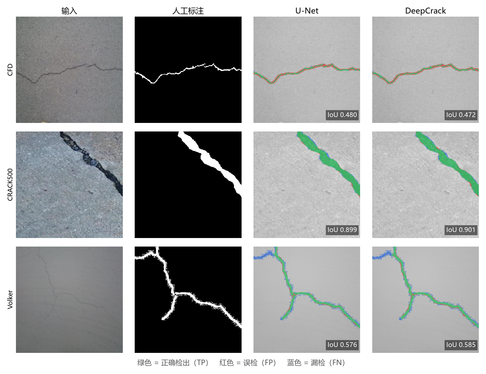
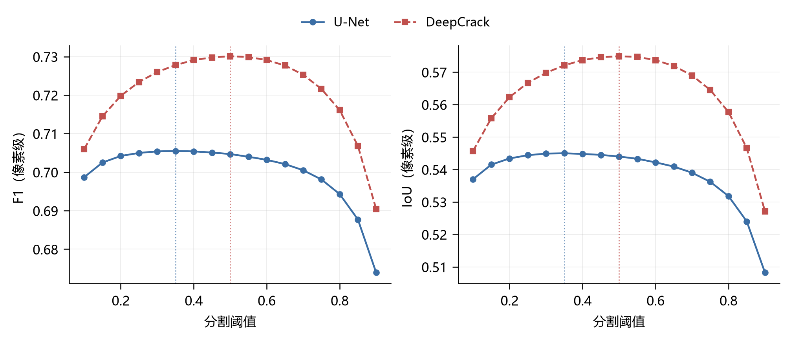
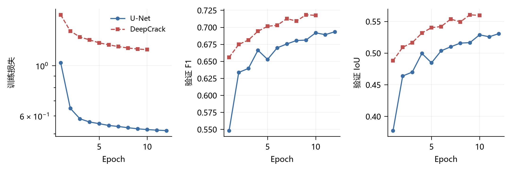

# Crack Segmentation — U-Net & DeepCrack Reproduction

Reproduction of pixel-level pavement crack segmentation on **CFD (CrackForest)** with a from-scratch **U-Net** baseline and **DeepCrack** (VGG16 + multi-scale side outputs + deep supervision).

Trained and evaluated end-to-end on a single 8 GB laptop GPU (RTX 5060 Laptop): fp16 AMP for U-Net, fp32 for DeepCrack (fp16 diverges on the 6-head deep-supervision loss — see the notes).

## Results

Test split: 1695 CFD images, 256×256 input, single run per model (seed 42).

| model | params | Precision | Recall | F1 | IoU | per-image F1 | FPS (bs=1) |
|---|---|---|---|---|---|---|---|
| U-Net (from scratch, 12 ep) | 7.8 M | 0.712 | 0.697 | 0.705 | 0.544 | 0.574 | 238 |
| DeepCrack (VGG16, 10 ep) | 14.7 M | 0.711 | 0.750 | **0.730** | **0.575** | 0.590 | 216 |

Measured on an RTX 5060 Laptop (8 GB), wall clock over 200 single-image forward passes. The threshold-sweep optimum was 0.50 for both models, so `@0.5` and `@best` coincide.

`per-image F1` averages the per-image F1 (small crack images weigh the same as large ones); the F1/IoU columns are micro-averaged over all pixels.



*Three test images picked to cover thin, thick and faint cracks; the number in each panel is the per-image IoU. Green = TP, red = false positive, blue = missed. The two models are nearly tied on the easy thick crack (0.899 vs 0.901); the visible difference is how much of the faint, low-contrast branches each one keeps, and on the whole test split DeepCrack buys its +0.025 F1 mainly through recall (0.750 vs 0.697).*



*Pixel-level F1 and IoU vs binarisation threshold (dotted lines = each model's best threshold: 0.35 for U-Net, 0.50 for DeepCrack). Both curves are flat between 0.2 and 0.8 (ΔF1 < 0.02), so the ranking does not depend on threshold tuning.*



*Training loss (log scale), validation F1 and validation IoU per epoch. U-Net was trained 12 epochs, DeepCrack 10 (each started from a different budget; the comparison is not epoch-matched).*

All three figures come from the same run as the table above: `python make_figs.py` regenerates them from `runs/*/history.csv`, `runs/*/best.pt` and `results/*/metrics.json`. Raw overlays (input / ground truth / prediction / error map, green = TP, blue = missed, red = false positive) are written by `evaluate.py` to `results/<model>/overlays/`.

Numbers behind the figures are committed under [`results/`](results/结果汇总.md):

| file | content |
|---|---|
| `results/结果汇总.md` | Chinese write-up: setup, main table, threshold table, takeaways |
| `results/metrics_{unet,deepcrack}.json` | 17-point threshold sweep + params + FPS + per-image F1 |
| `results/threshold_sweep.csv` | both models' sweeps flattened into one table (34 rows) |
| `results/history_{unet,deepcrack}.csv` | per-epoch loss / val P / val R / val F1 / val IoU / lr / time |
| `results/config_{unet,deepcrack}.json` | training hyper-parameters (seed 42, bs 4, lr 1e-4 …) |

Both models are below the ~0.80 F1 reported in the DeepCrack paper: this reproduction uses 256² input instead of 448², 10–12 epochs instead of hundreds, and never tunes the threshold on the test split. The gap is a compute budget, not a training bug — the curves are still rising at the last epoch.

## What is here

| file | role |
|---|---|
| `extract.py` | parquet → `data/cfd/{train,test}/{images,masks}` (JPG images, lossless PNG masks) |
| `dataset.py` | dataset + geometric/photometric augmentation, 10 % val split by seed |
| `models.py` | `UNet(base=32)` and `DeepCrack` (VGG16 encoder, 5 side heads, 1×1 fusion) |
| `losses.py` | BCE + Dice, deep-supervision weighting, confusion matrix → P/R/F1/IoU |
| `train.py` | AdamW + cosine, grad clip, best-on-val-F1 checkpointing, `--amp/--freeze-bn/--side-weight` knobs |
| `evaluate.py` | threshold sweep, per-image & micro metrics, params, FPS, error-map overlays |
| `make_figs.py` | result figures: qualitative comparison, threshold sweep, training curves |
| `docs/原理与调试笔记.md` | Chinese notes: the theory, how to run, how to debug (symptom → cause → fix) |
| `docs/figures/` | result figures used in this README (PNG, 300 dpi) |
| `results/` | committed result snapshot: write-up, metrics JSON, threshold CSV, per-epoch history, configs |

## Quick start

```bash
uv venv --python 3.12 env
uv pip install --python env/Scripts/python.exe torch torchvision --index-url https://download.pytorch.org/whl/cu128
uv pip install --python env/Scripts/python.exe numpy opencv-python-headless pyarrow pillow tqdm matplotlib

python extract.py --src data --dst data/cfd
python train.py --model unet      --epochs 12 --batch 4 --size 256
python train.py --model deepcrack --epochs 10 --batch 4 --size 256 \
                --lr 1e-4 --amp 0 --freeze-bn 1 --side-weight 0.25 --clip 1.0
python evaluate.py --ckpt runs/deepcrack/best.pt --out results/deepcrack
```

Set `PYTORCH_CUDA_ALLOC_CONF=expandable_segments:True` if the allocator fragments (harmless warning on Windows: the flag is accepted but not applied).

## Design notes

- **Loss = BCEWithLogits + Dice.** Cracks are 1–2 % of pixels; BCE alone collapses to all-background with a deceptively low loss. Dice optimises overlap directly.
- **Deep supervision, side weight 0.25, fuse weight 1.0.** Six outputs summed gives 2–3× the gradient magnitude of a single-head loss; at 0.5 the model diverged after epoch 3. 0.25 keeps the total scale near 2.25×.
- **Resize, not random crop.** CFD cracks often run across the whole frame; cropping cuts the line and teaches the model wrong continuity.
- **Augmentation stays topology-preserving** (flips, 90° rotations, mild brightness/contrast). Elastic warps invent forks that do not exist.
- **Threshold is swept, not assumed.** `@0.5` and `@best` are both reported; `@best` is selected on validation only.

## Notes on measured behaviour

| observation | explanation |
|---|---|
| first iteration takes 40–60 s | `cudnn.benchmark=True` autotunes every new conv shape once |
| `channels_last` is 2.6× slower for U-Net (93 → 36 img/s) | layout conversion + BatchNorm overhead dominates at small channel counts |
| OOM at batch 8 with 6 GB reported free | 8 GB card shared with the desktop; fragmentation; fixed by bs 4 + `expandable_segments` |
| training dies mid-run with `WinError 1455 页面文件太小`, traceback inside a dataloader worker's `import torch` | Windows spawns each worker as a fresh process that re-imports CUDA torch (~1 GB commit); 16 GB RAM + small pagefile blows the commit limit; fixed with `--workers 0` |
| DeepCrack loss rises from epoch 3 and turns NaN at epoch 7 (fp16) | 6 summed BCE+Dice terms + fp16 Dice global sums overflow; fixed by computing the loss in fp32 (`--amp 0`), side weight 0.5 → 0.25, pretrained BN frozen, grad clip 1.0 (pre-clip norm is 60–140 every epoch, so the clip is doing real work) |

## Data

`varcoder/crack-segmentation-dataset` on HuggingFace (CFD, 9603 train / 1695 test, 448×448). Dataset files and weights are not committed; `extract.py` rebuilds the folder layout.

## Reference

Liu, Y., Yao, J., Lu, X., Xie, R., Li, L. *DeepCrack: A deep hierarchical feature learning architecture for crack segmentation.* Neurocomputing 338 (2019) 139–153.
